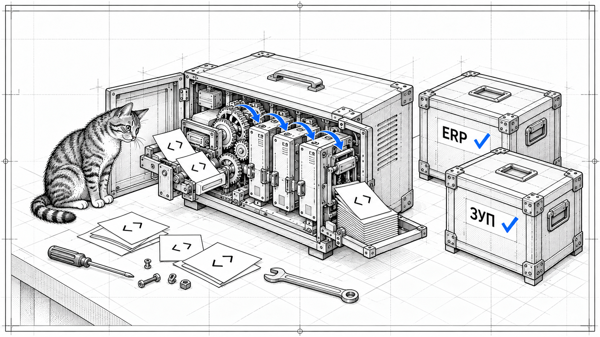

<div align="center">

# Развертка

### Файл конфигурации ↔ XML. Из командной строки и вашего кода.

**cf-unwrapper** — открытый движок форматов 1С на Rust.

[Скачать для Windows](https://github.com/RunetX/cf-unwrapper/releases/latest/download/cf-unwrapper.exe) · [Быстрый старт](#быстрый-старт) · [Результаты](#результаты) · [Команды](#команды) · [Участие](CONTRIBUTING.md)


[](LICENSE)

[](https://infostart.ru/1c/articles/2833995/)

**[Развертка: закрываем расхождения и открываем исходники](https://infostart.ru/1c/articles/2833995/)**

Результаты ERP и ЗУП, методика проверки и развитие проекта — в статье на Инфостарте.

</div>



Развертка читает контейнеры `.cf`, `.cfe`, `.epf`, выгружает метаданные в XML и собирает файл из выгрузки. Установка платформы и создание информационной базы для этих операций не требуются.

Используйте CLI для выгрузок, скриптов и проверок или подключайте библиотеку к своему инструменту. Это самостоятельный проект, выделенный из constructor / cfkit.

```text
                          Развертка
                   ┌──────────────────┐
 .cf/.cfe/.epf ────►│ export    import │◄────── XML + BSL + макеты
            ◄──────│                  │──────►
                   │ unpack      pack │
 контейнер ────────►│                  │◄────── записи + .cfkit
            ◄──────└──────────────────┘──────►
```

## Возможности

| Задача | Что есть |
| --- | --- |
| Изучить файл | Информация о конфигурации, дерево метаданных, записи контейнера, текст модулей, поиск |
| Работать с XML | Выгрузка и загрузка конфигураций, расширений и внешних обработок, отдельная выгрузка форм |
| Выбрать формат | XML 2.21; понижение до 2.20 и 2.17 по встроенным таблицам |
| Работать с контейнером | Распаковка и сборка, W32/W64, составные контейнеры, временные метки |
| Проверить результат | Проверка контейнера, сравнение XML-деревьев и записей после загрузки |
| Создать обработку | Минимальная внешняя обработка командой `new-epf` |

Форматная часть включает управляемые формы, MXL, графические схемы, карты маршрутов, командный интерфейс, регистры и разбор запросов для загрузки динамических списков. Поддержка контейнера `.cfe` сама по себе не означает полноту XML-преобразований любого расширения.

Для `.cfe` реализован цикл CFE → XML → CFE с сохранением заимствования и расширяемых свойств. На Контур.КЭДО для ЗУП 1.27.3 результат принят платформой: все 2453 файла повторной XML-выгрузки совпали с исходным эталоном. Поддержанные классы, совместимость и ограничения описаны в [документации расширений](docs/cfe-support.md).

## Быстрый старт

### Готовая утилита для Windows x64

**[Скачать cf-unwrapper.exe](https://github.com/RunetX/cf-unwrapper/releases/latest/download/cf-unwrapper.exe)** или [ZIP с инструкцией](https://github.com/RunetX/cf-unwrapper/releases/download/v0.2.0/cf-unwrapper-v0.2.0-windows-x86_64.zip). Rust и установка платформы не нужны. Контрольные суммы SHA-256 и описание версии — на [странице релиза](https://github.com/RunetX/cf-unwrapper/releases/latest).

Это консольная программа: откройте PowerShell в каталоге скачанного файла и выполните:

```powershell
.\cf-unwrapper.exe --help
.\cf-unwrapper.exe export .\1Cv8.cf .\src
.\cf-unwrapper.exe import .\src .\rebuilt.cf
```

### Сборка из исходников

Нужны Git и **Rust stable** с Cargo:

```sh
git clone https://github.com/RunetX/cf-unwrapper.git
cd cf-unwrapper
cargo build --release --locked --bin cf-unwrapper
```

Бинарник: `target/release/cf-unwrapper` (Windows: `target/release/cf-unwrapper.exe`). Добавьте каталог в `PATH` или вызывайте файл по полному пути. Далее предполагается, что команда доступна в `PATH`.

### Выгрузить и собрать конфигурацию

```sh
cf-unwrapper export 1Cv8.cf src
cf-unwrapper import src rebuilt.cf
cf-unwrapper verify rebuilt.cf
```

### Выбрать версию XML

```sh
cf-unwrapper export 1Cv8.cf src-2.20 --format 2.20
cf-unwrapper export 1Cv8.cf src-2.17 --format 2.17
```

Нативный формат — 2.21. Явный `--format 2.21` также поддерживается. Соответствия проверенных версий платформы: 8.5 — 2.21, 8.3.27 — 2.20, 8.3.24 — 2.17. Выбор XML-формата не меняет режим совместимости конфигурации.

### Попробовать без своей конфигурации

```sh
cf-unwrapper new-epf DemoProcessor demo.epf
cf-unwrapper export demo.epf demo-src
cf-unwrapper import demo-src/DemoProcessor.xml demo-rebuilt.epf
cf-unwrapper export demo-rebuilt.epf demo-again
cf-unwrapper xml-diff demo-again demo-src 3
```

## Результаты

Регрессия исходного движка **до выделения** в этот репозиторий, 30 октября 2026 года. Эталоны — результаты платформы 8.5.1.1529. Сами конфигурации в репозиторий не включены.

| Конфигурация | Выгрузка: совпало файлов | Загрузка: совпало записей | Отказов загрузки |
| --- | ---: | ---: | ---: |
| Клиент ЭДО 2.9 | 21 758 / 21 758 | 17 626 / 17 626 | 0 |
| Бухгалтерия предприятия 3.0.171.23 | 90 385 / 90 385 | 77 265 / 77 266¹ | 0 |
| Бухгалтерия предприятия 3.0.107.34 | 68 742 / 68 742 | 58 637 / 58 637 | 0 |
| Зарплата и управление персоналом 3.1.37.54 | **40 560 / 40 560** | **33 966 / 33 966** | **0** |
| ERP 2.5.22.186 | **121 712 / 121 712** | **102 375 / 102 375** | **0** |

¹ Один макет БП различается из-за зависимого от адресов картинок в памяти объединения оформлений платформой. Это известная граница побайтовой сверки.

Для ERP и ЗУП проверен и круг через платформу: собранный движком файл загружен в базу и выгружен в XML. Результат совпал с таким же кругом по файлу, собранному самой платформой: **121 712 / 121 712** и **40 560 / 40 560** файлов. С исходным XML оба варианта круга имеют одинаковые отличия — 16 файлов ERP и 7 файлов ЗУП.

Это результаты конкретных конфигураций и версий. Служебная запись `versions` со случайными GUID из сверки записей исключена. Таблица не означает побайтового равенства всего `.cf` или поддержки всех возможностей платформы. После выделения самостоятельный workspace проверялся синтетическими тестами; повторный прогон этих пяти конфигураций в новом репозитории пока не проводился.

## Команды

| Команда | Назначение |
| --- | --- |
| `info <file>` | Информация о файле и группах метаданных |
| `tree <file> [--all]` | Дерево метаданных |
| `ls <file>` | Записи всех частей контейнера |
| `cat <file> <entry>` | Содержимое записи |
| `module <file> <entry>` | Текст модуля |
| `search <file> <text>` | Поиск текста |
| `verify <file>` | Проверка контейнера |
| `unpack <file> <directory>` | Распаковать записи |
| `pack <directory> <file>` | Собрать контейнер из записей |
| `export <file> <directory> [selection] [--format VERSION]` | Выгрузить XML: 2.21, 2.20 или 2.17 |
| `export-forms <file> <directory> [selection]` | Выгрузить формы |
| `import <directory-or-external.xml> <file>` | Собрать файл из XML |
| `new-epf <name> <file.epf>` | Создать внешнюю обработку |
| `xml-down <source> <destination> --format VERSION` | Понизить готовую XML-выгрузку до 2.20 или 2.17 |
| `xml-diff <ours> <reference> [N]` | Сравнить XML-деревья, показать до N примеров |
| `import-check <xml> <records-dir> [selection-or-dash] [N]` | Сравнить результат загрузки с записями эталона |

Справка: `cf-unwrapper --help`. Запуск из workspace: `cargo run -p cf-unwrapper-cli -- --help`.

`selection` — UTF-8-файл с путями объектов, по одному на строку. Для `import-check` значение `-` означает все объекты. Выбор части контейнера для `import-check` описан в [справочнике CLI и API](docs/cli-reference.md).

### Как читать результаты

`xml-diff` и `import-check` возвращают успешный код при выполненном сравнении, **даже если найдены различия**. В автоматизации проверяйте счетчики отчета: различия, лишние и недостающие файлы, отказы. Нулевой код сам по себе не означает совпадения.

Ошибки аргументов, чтения, неподдерживаемого формата и отказы `import` дают ненулевой код. Если при загрузке отвергнут хотя бы один входной файл, `import` не создает и не заменяет результат. Выгрузка и понижение формата могут оставить успешно записанные файлы, если на другом объекте возник отказ.

Загрузка может нормализовать внутренние записи. Для проверки загрузки эталоном служит файл, собранный платформой из того же XML. Для проверки XML-круга:

```sh
cf-unwrapper import src rebuilt.cf
cf-unwrapper export rebuilt.cf src-again
cf-unwrapper xml-diff src-again src 3
```

## Библиотека для ваших инструментов

```text
crates/
├── cf-unwrapper/       библиотека, import: cf_unwrapper
└── cf-unwrapper-cli/   CLI, бинарник: cf-unwrapper
```

Единственная прямая внешняя runtime-зависимость библиотеки — `flate2`; CLI напрямую зависит только от библиотеки.

```rust
use cf_unwrapper::{meta::Config, xml};

fn main() -> Result<(), String> {
    let bytes = xml::imp::new_external("DemoProcessor")?;
    let config = Config::open(&bytes)?;
    println!("{}", config.root.header.name);
    Ok(())
}
```

Публичные модули: `container`, `brace`, `meta`, `unpack`, `xml` и вспомогательный разборщик запросов. Модели форм находятся в `xml::form`. Детали — в [README библиотеки](crates/cf-unwrapper/README.md) и [справочнике CLI и API](docs/cli-reference.md). Документация API: `cargo doc -p cf-unwrapper --no-deps --open`.

## Помогите проверить следующую конфигурацию

ERP и ЗУП закрыли большой набор случаев, но следующий пробел может оказаться в маленькой обработке. Нужны проверки других версий, минимальные примеры ошибок, тесты и улучшения документации. Знание Rust пригодится для кода; для проверки своей конфигурации оно не требуется.

- **Проверили свою конфигурацию?** [Расскажите о результате](https://github.com/RunetX/cf-unwrapper/issues), укажите версии и счетчики сравнения.
- **Нашли расхождение?** Приложите небольшой синтетический пример и команды воспроизведения.
- **Хотите доработать движок?** Посмотрите [как внести вклад](CONTRIBUTING.md) и предложите изменение через pull request.

Особенно полезны проверки расширений, внешних обработок, старых режимов совместимости и редких свойств форм. Не прикладывайте рабочие конфигурации, выгрузки или данные клиентов: ошибку нужно свести к примеру, которым вы вправе поделиться.

## Разработка и проверки

Нужны Rust stable с `rustfmt` и Python 3.11+:

```sh
cargo build --workspace --locked
python tools/check.py
```

`check.py` проверяет аудит ресурсов, сохранность их байтов при Git checkout, форматирование нового кода, тесты workspace и реальную сборку пакета через `cargo package`. Проверки не требуют платформы или закрытых конфигураций. Workflow [Check](https://github.com/RunetX/cf-unwrapper/actions/workflows/check.yml) настроен на Windows и Linux.

Локальные проверки своих конфигураций храните в игнорируемом `local/`, пути передавайте явно. Сверяйте результат с доверенной выгрузкой платформы. Такие проверки выполняются отдельно от синтетического CI.

## Границы проекта и лицензия

Это восстановленная реализация форматов с явно обозначенными неподдерживаемыми случаями. GUI, отладчик, BSL-сервер, запуск платформы и интеграция с constructor в этот репозиторий не входят. Форматные примитивы редактирования доступны в библиотеке; отдельных CLI-команд редактирования модели нет. Подписи метаданных используют статические значения и не требуют ресурсов платформы.

Исходный код объявлен под [MIT](LICENSE). Происхождение встроенных ресурсов, включая платформенные seed/default templates, отдельно описано в [аудите переноса](docs/extraction-audit.md) и [инвентаризации ресурсов](docs/embedded-assets.md). Техническая проверка этих файлов не устанавливает права на распространение сторонних материалов.
